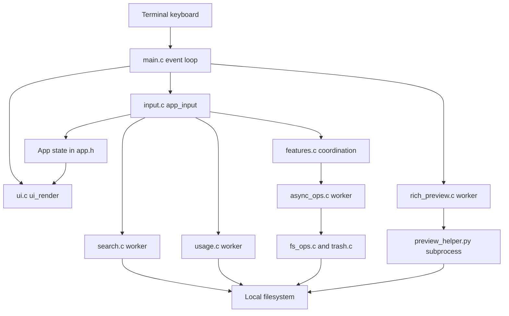
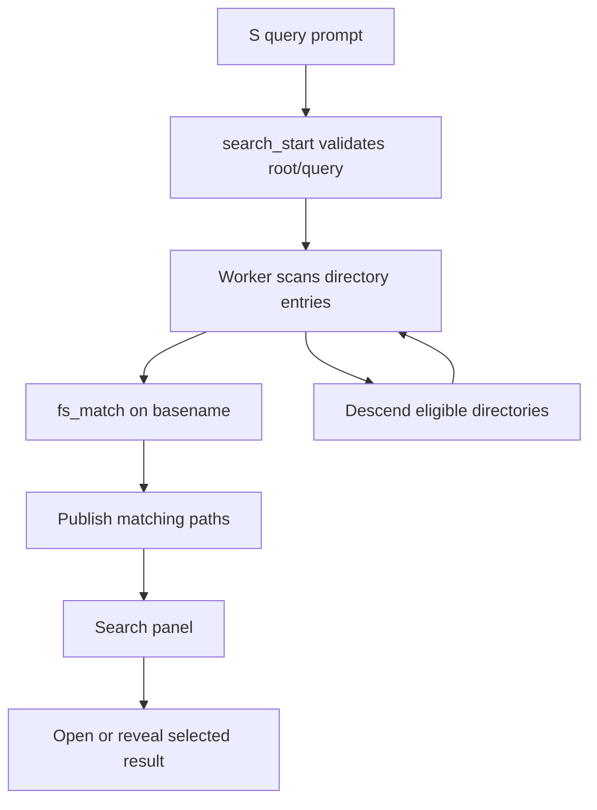
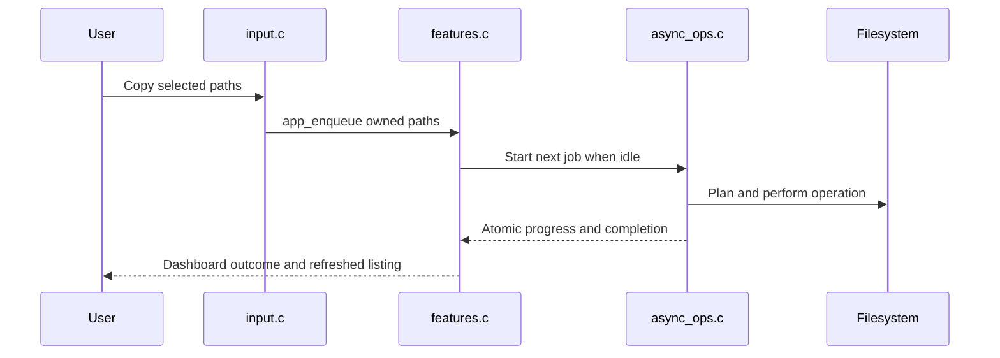
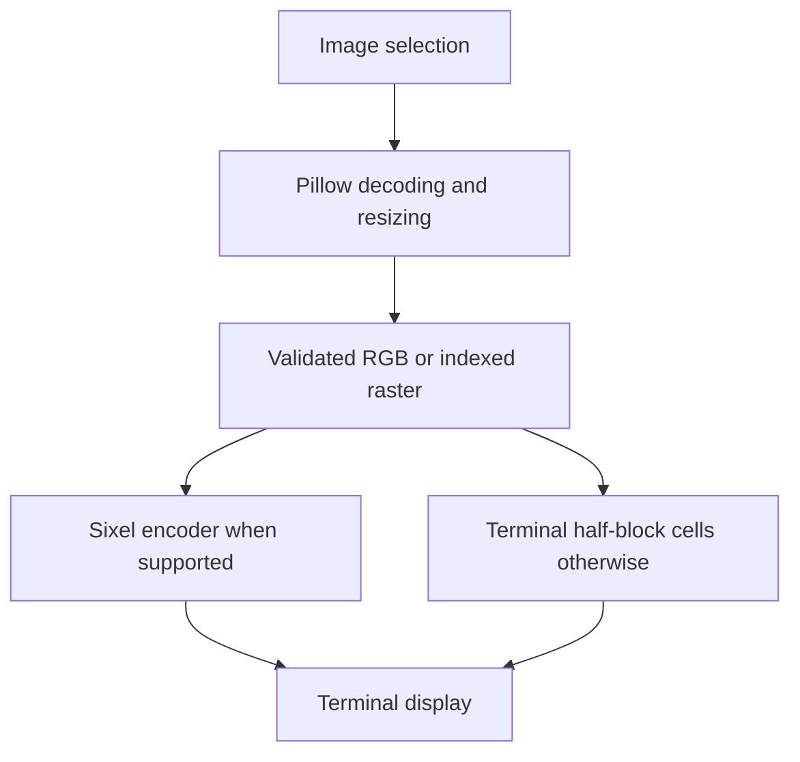

# Understanding TermNav

Source review: 8 October 2026, revision `13599afee55c65c6a8e44523d6c1e87c3806f8f4` (`Added a search feature`). This guide describes the implementation at that revision. Application source was unchanged during this review; three research-paper artifacts were already untracked.

TermNav is a keyboard-driven file manager written in C. It reads real directories, displays a Home dashboard and file browser, previews selected entries, and performs file operations through background workers. It runs on Linux, including Linux inside Windows Subsystem for Linux (WSL). Its Windows launcher starts that Linux application; there is no native Windows or macOS implementation here.

## 1. The overall structure

There is one application process, one shared application state, and several kinds of worker. The main thread owns keyboard handling and terminal drawing. Workers handle potentially slow operations and publish results for the main thread to collect. Rich previews additionally start a Python helper process. There is no web server, database service, network API, or frontend/backend split.

Arrows describe calls or data flow, not separate deployed services. Diagram structure was checked against source; a Mermaid rendering validator was not run.

### Source map

| File | Responsibility and useful starting symbols |
|---|---|
| `src/app.h` | Central `App` state, input modes, panels, queue and operation log limits |
| `src/main.c` | `main`, configuration, navigation, filtering, selection and preview coordination |
| `src/input.c` | `app_input`, prompts, browser/viewer/Home/panel controls and target collection |
| `src/ui.c` | Curses windows, text clipping, Home cards, capacity bars, panels, preview drawing |
| `src/features.c` | Queue scheduling, completed operation records, undo, panel opening and history replay |
| `src/fs_ops.c` / `.h` | Directory listing, sorting, matching, path helpers, mkdir, rename, copy and delete |
| `src/async_ops.c` / `.h` | Worker lifecycle, progress, pause and cancellation for filesystem operations |
| `src/trash.c` / `.h` | Persistent private trash records and collision-safe restoration |
| `src/history.c` / `.h` | Bounded in-memory directory history |
| `src/commands.c` / `.h` | Palette action registry and fuzzy matching |
| `src/search.c` / `.h` | Recursive filename search and result publication |
| `src/usage.c` / `.h` | Allocated/apparent size measurements and asynchronous directory scans |
| `src/drives.c` / `.h` | Mounted-drive discovery and available/total capacity |
| `src/preview.c` / `.h` | Basic text, binary, directory, symlink and special-file previews |
| `src/rich_preview.c` / `.h` | Bounded external helper execution and validated preview results |
| `scripts/preview_helper.py` | Image decoding/resizing, PDF text and archive member listings |
| `src/image_terminal.c` / `.h` | Terminal capability negotiation and cell dimensions |
| `src/sixel.c` / `.h` | Indexed raster to Sixel escape-sequence encoding |
| `src/editor.c` | External editor subprocess, without shell command interpretation |

The `.h` files specify structures and callable interfaces. The `.c` files implement them. `Makefile` compiles every `src/*.c` into the single `termnav` executable.

## 2. Shared state and ownership

`App` is the connection between behavior and presentation. For example, `input.c` changes the selected row, `main.c` obtains its preview, and `ui.c` draws that same state.

| State | Meaning | Lifetime |
|---|---|---|
| `current`, `parent` listings | Entries and metadata for browser panes | Replaced on successful navigation/reload; freed at shutdown |
| `visible`, cursor and scroll | Indices into the current listing after filtering | Rebuilt when filtering/listing changes |
| Entry marks and clipboard paths | Batch selection and internal copy clipboard | Session only; clipboard stores paths, not file contents |
| `Preview`, `RichPreview` | Displayable data and an in-progress helper request | Changed with selection, refresh or layout |
| Active `Job`, pending queue | Owned source paths and operation parameters | Queue transfers ownership to the worker; collection frees them |
| Operation log | Recent completed outcomes | Session only, up to 32 records |
| `History` | Paths plus selection/filter/scroll snapshots | Session only, up to 64 entries |
| Search and usage state | Worker results and progress | Freed after cancellation/join when closed/restarted |
| Trash registry/payloads | Recovery metadata and removed files | Persistent on disk across sessions |

`app_selected()` translates the cursor through `visible[]` before returning an entry. Filtering therefore changes the view, rather than deleting entries from the underlying listing. Batch target collection includes marked entries even when a filter currently hides them; with no marks it uses the selected entry.

The operation queue holds up to 16 pending jobs and runs one filesystem job at a time. Search and usage have mutex-protected result data. Worker completion, progress and cancel/pause flags use atomic values. The main thread collects or joins workers before freeing their data; workers do not draw curses windows.

## 3. Startup, configuration, loop and shutdown

Read `src/main.c:main` alongside `app_config`, then `ui_init` in `src/ui.c`.

1. Set the locale, initialize `App`, read configuration, and inspect `NO_COLOR`.
2. Parse `-a`, `--ascii`, `--no-color`, `--home`, help/version options, `--`, and an optional directory.
3. Require an interactive terminal on input and output. Help/version can return before this check.
4. Load the initial directory. No explicit directory starts the Home dashboard; `--home` also starts Home when a directory is supplied.
5. Install signal handlers and initialize wide-character ncurses.
6. Repeatedly collect rich-preview results, advance the operation queue, refresh eligible directory/drive data, render, and read a key with an 80 ms input timeout.
7. On exit, cancel/join outstanding workers, discard queued work, free owned data, and restore the terminal through curses shutdown.

Directory polling is approximately every two seconds and is gated by the current mode/panel, active operation and viewer state. It does not continually reset a fullscreen reader. Home drive capacity refreshes approximately every five seconds, with an immediate refresh request available through `R`.

Configuration is `$XDG_CONFIG_HOME/termnav/config`, otherwise `$HOME/.config/termnav/config`. `config.example` shows the implemented settings: `show_hidden`, `ascii`, and `sort` (`name`, `size`, `modified`). Command-line options can override settings. Configuration is read at startup; it is not an automatically saved preferences database.

The signal handler only sets a stopping flag; normal cleanup performs cancellation and terminal restoration. Interactive quitting with active/queued jobs asks for confirmation. A hard kill or power failure cannot run that cleanup.

## 4. Navigation, Home and directory listings

**Trigger:** `Enter`/`l` on a directory, `h` to its parent, `o` followed by a path, or opening a Home folder/drive.

**Trace:** `app_input` → browser/Home handler → `app_navigate` → `load_current` → `fs_list` → `app_filter` / `app_preview` → `ui_render`.

`fs_list` canonicalizes the path with `realpath`, opens the directory, gathers entry metadata, grows its array as necessary, and sorts directories before files. Sort choices are name, descending size, or descending modified time. Listings are dynamic; the original 1,024-entry requirement is not a current listing cap.

`load_current` prepares the new listing and visible-index allocation before replacing the old listing. If opening a new folder fails, the previous listing remains available and a status message explains the error. Reloads preserve marks for matching name/inode entries. The parent pane is a separate listing, loaded on a best-effort basis.

Home uses the same current listing and navigation functions as the browser. `home_input` routes keys according to one of three focus areas: quick folders, current files, and drives. `Tab` switches areas. `F1` returns to Home from normal-mode panels/viewers; it does not discard an active text prompt. `w` toggles Home/browser.

The four quick-folder locations are resolved by `app_quick_path`: `TERMNAV_USER_HOME`, `TERMNAV_DOWNLOADS`, `TERMNAV_DOCUMENTS`, and `TERMNAV_PICTURES` can override Linux defaults. `termnav.ps1` discovers Windows known folders, converts their paths through WSL, and passes those values. This matters for redirected OneDrive folders and paths containing spaces. The browser's `~` shortcut uses Linux `HOME`, which may differ from the Windows Home card.

Drive cards come from `drives_read` in `src/drives.c`: it reads `/proc/mounts`, retains root, relevant device mounts and Windows mounts, removes certain duplicates/unwanted mounts, then calls `statvfs`. There are up to 16 drive records. Cards show detected mounts, not four hard-coded drive letters. A drive must be mounted and pass discovery rules to appear.

Capacity uses `total = f_blocks × f_frsize` and `available = f_bavail × f_frsize`. The bar shows `(total − available) / total`; blocks reserved from ordinary users therefore contribute to the occupied portion. `home_bar` draws the bar, and `home_folder` draws terminal folder outlines. Layout shrinks cards/panels when terminal space is limited.

**Example:** Home → Tab to files → Right on `projects` opens that actual folder. An inaccessible drive reports an opening failure instead of pretending navigation succeeded.

## 5. Filtering, selection and command palette

**Local filtering:** `/` edits a query, `app_filter` tests current filenames through `fs_match`, and the visible-index list changes immediately. No worker and no recursion are involved.

`fs_match` is subsequence matching: `tfm` matches `Terminal_File_Manager`. It decodes complete UTF-8 characters and folds ASCII case. It is not regex matching, full Unicode case folding, or a ranked relevance algorithm.

`Space` marks an entry and advances selection. `v` toggles visible marks. `y` remembers selected/marked absolute paths in TermNav's internal clipboard; `p` queues copies into the current directory. It does not write the desktop clipboard.

**Palette:** `:` → `palette_input` → `command_matches` → a registered key → `app_input`. The registry in `src/commands.c` currently contains **25 actions**. Matching combines each action's name and description and preserves registry order. Selecting an action reuses existing input behavior; the palette is not a shell and does not execute arbitrary typed commands.

Input routing is mode-dependent. Home, feature panels, the fullscreen viewer, help and text prompts each handle keys before ordinary browser shortcuts. Consequently `q` closes a viewer but quits from the browser, and `Tab` switches Home focus but expands a browser preview.

## 6. Recursive filename search

**Trigger:** `S`, enter a query, then Enter; or the palette's recursive search action.

**Trace:** `submit` → `search_start` → worker / `walk` → `fs_match` → mutex-protected results → search panel → result open/reveal navigation.

The root is the current directory. Search matches each entry's basename, not file contents or the entire relative path. Results are accumulated in filesystem discovery order. The worker searches subdirectories while the terminal remains responsive.

Hidden traversal follows the current hidden-files setting. Symlinks are not recursively followed. Traversal remains on the root device, skips inaccessible entries, and limits directory depth. Results stop at **1,000**: reaching the cap sets `limited` and stops further traversal. A matching mount-point entry can appear even though search does not descend into that other device.

In the search panel, `Enter` opens a directory or previews a file after navigating to its parent; `o` reveals the result's location; `R` rescans; `S` starts another query; `x` requests cancellation while retaining accumulated results. Closing/restarting cancels, joins and frees search data. Failed navigation leaves the search panel available.

**Example:** Searching `report` from a workspace can find `nested/Report.txt`; `/report` only filters names in the current directory. Search has no persistent index, so broad searches repeat filesystem work and may stop before discovering all possible matches.

## 7. File operations and the dashboard

**Trigger:** `c` plus an existing destination, `p`, confirmed trash/delete, or restore.

**Trace:** target collection in `input.c` → `app_enqueue` → `app_operations_tick` → `job_start_kind` → worker → filesystem function → completion collection/log → deferred browser reload.

The four job kinds are copy, permanent delete, trash and restore. Creating a directory and renaming are direct operations, with protection against performing them during an active filesystem job. There is no general cut/paste or cross-directory move job.

`async_ops.c` measures copy/delete work before execution, processes source paths, and reports byte/file progress through callbacks. Pause waits cooperatively; cancellation is checked at traversal/copy checkpoints. A batch stops on its first error. Files completed before an error remain completed.

The operations panel (`t`) draws active, queued and recently completed rows. `Space` pauses/resumes an active job. `x`/`c` requests active cancellation or removes the selected queued job. Completed records show outcomes but are not executable jobs. At shutdown the queue is freed and the active worker is canceled/joined.

### Important filesystem blocks

* `copy_at` handles regular files, directory recursion and symlinks. Regular data moves in 128 KiB chunks with interrupted/short-write handling. A temporary destination file is created exclusively, written, given metadata, synced, and published without replacing an existing destination.
* Directory copy stages directory permissions during recursion and applies metadata afterward. Copying a directory into its own descendant is rejected. Symlinks are copied as links. Unsupported special files fail explicitly.
* `delete_at` uses descriptor-relative traversal and does not follow directory symlinks. It removes children before the parent and rejects dangerous root/relative targets. Recursion is bounded.
* `fs_mkdir` and `fs_rename` validate single-entry names. Rename uses Linux's no-replace operation, so an existing destination is not silently overwritten.

Cancellation does not roll back an entire directory tree or a multi-source batch. A partially copied directory or partially deleted tree can remain. Copy also does not implement complete archival preservation of ownership, ACLs, extended attributes or hard-link relationships.

Prompt safety is connected to reload scheduling: operation completion defers directory reload while a confirmation is open, so a disappearing selection does not silently turn the confirmation into an operation on the next row. The regression scenario is in `tests/test_app.c`.

## 8. Trash and undo

**Trigger:** `d`, type `trash`, Enter; `u` restores the newest trash batch; `T` opens individual recovery items. `X` requires typing `delete` and bypasses recovery.

**Trace:** input confirmation → queued trash/restore job → `trash_put` / `trash_restore` in `src/trash.c` → registry refresh and directory reload.

TermNav has its own trash system. It does not use Windows Recycle Bin or the desktop Linux trash specification. Payloads move into `.termnav-trash-<uid>` beside their original location, keeping the move on that filesystem. Metadata lives in `$XDG_DATA_HOME/termnav/trash`, otherwise `$HOME/.local/share/termnav/trash`.

Records use a bounded binary format with magic `TNTRASH1`, a batch identifier, time and original/stored paths. Registry access is locked with `flock`; private directory ownership/permissions and no-follow opens are checked. Records and stored paths are validated before recovery. The record representation is C-structure based, so portability between different ABIs is not established.

`trash_put` writes/syncs metadata before publishing the payload move and cleans metadata on a failed move. `trash_restore` refuses an occupied original path, leaving the recoverable item available. A missing original parent causes a restoration error; it is not automatically recreated. Listing skips invalid records and missing payloads.

**Example:** Trash two marked files in one batch, restart TermNav, then press `u`: persisted batch metadata allows recovery. If a new file now occupies an old name, restoration reports a collision rather than overwriting it.

Undo is specifically trash recovery, not an undo history for copy, rename, mkdir or permanent delete. Persistent records are not a full transaction journal with guaranteed power-loss recovery.

## 9. Directory history

**Trigger:** `b` back, `f` forward, `H` history panel and selected jump.

**Trace:** `app_navigate` saves the current view → `history_push` records successful navigation → `app_history_jump` replays navigation without creating another history entry → filter/selection/scroll restoration.

History holds 64 entries in memory. Repeated visits to the same current path do not append duplicates; navigating from an earlier entry discards the forward branch; the oldest entry is evicted when full. Selected names are restored when possible, with cursor clamping as fallback. Failed navigation does not advance the history position. History is lost when the application exits.

## 10. Disk usage explorer

**Trigger:** `D` opens a scan of the current directory. The panel can drill into a directory and rescan its parent.

**Trace:** `app_usage_open` → `usage_start` → `scan_worker` → `usage_measure` / `measure_at` → mutex-protected totals → usage panel.

This feature answers a different question from a drive bar. A drive bar measures filesystem capacity; the explorer measures directory contents. Apparent bytes come from regular-file sizes. Allocated bytes come from `st_blocks × 512`, which exposes differences caused by sparse files and allocation granularity. Child items are sorted by allocated size after completion.

Scans include hidden entries, avoid following symlinks, bound recursion and report skipped/error counts. They can be canceled and are joined before their result storage is freed. Unlike recursive search, usage traversal does not enforce a same-device boundary. There is no hard-link inode deduplication, so multiple names for the same file can be counted repeatedly. Totals for the scanned directory are sums of its children rather than adding that root directory's own blocks.

## 11. Basic and rich previews

**Trigger:** selection changes request a preview; `Tab` expands it; selecting a file with Enter opens the fullscreen reader.

**Trace:** `app_preview` chooses/cache-checks → `preview_load` or `rich_start` → completion collection → `draw_preview`.

`preview_load` treats entry types separately: a symlink shows its target, a directory shows entries, a special file shows metadata, and a regular file is read through a no-follow, nonblocking open. Basic data is bounded to 64 KiB. NUL/control-byte detection chooses text versus binary. Text builds line offsets once; hex displays 16 bytes per row. Extension-based highlighting in `code_line` is a lightweight lexer, not a language parser.

The fullscreen viewer is read-only. Vertical movement scrolls rows and horizontal movement pans long text. Its input handler prevents browser mutations while reading. Images fit available space; there is no interactive image zoom implementation.

For supported images, PDFs and archives, `rich_preview.c` starts `scripts/preview_helper.py`. It checks file identity, passes an already-open source through a child descriptor, uses an argument array rather than a shell, bounds output, and enforces a five-second parent deadline. Cancellation terminates the helper process group. The helper also applies resource limits.

* PDF previews extract text from the first five pages with `pdftotext`; they do not render PDF pages or perform OCR.
* ZIP/tar previews list up to 512 members without extraction. Output is bounded; a lookahead byte lets the C reader distinguish exactly 64 KiB from truncation.
* Images require Pillow. The helper applies orientation, composites transparency, preserves aspect ratio and uses Lanczos downsampling. Native indexed output uses a 256-color palette.

Missing tools, malformed data and timeouts produce preview error messages. Failure to start a rich worker can fall back to basic preview; a completed helper failure is displayed as a rich-preview error. The cache includes file identity/size/mtime, dimensions and renderer, so a resize or relevant file change triggers another request.

### Why terminal image quality varies

`image_terminal_probe` queries terminal capabilities and cell dimensions; it does not infer graphics support from a terminal's name. `TERMNAV_IMAGE=auto`, `sixel`, or `blocks` controls selection. Automatic detection falls back under tmux and when Sixel support is absent; ASCII/no-color modes disable automatic graphics probing.

Sixel encodes six vertical pixels per bit-pattern column, palette references and repeated runs. `sixel_encode` bounds dimensions to 1,280 × 960 and output to 8 MiB. C validates helper dimensions and payload lengths before accepting image data. Native graphics are drawn after curses output and invalidated for selection/layout/overlay changes; unchanged images are not retransmitted every loop.

The fallback maps colors to terminal color pairs and uses `▀` for two vertical samples per cell. It can therefore remain visibly pixelated even when image decoding is high quality: terminal cell geometry limits detail. Sixel improves detail on a supporting terminal, but still has palette, fit-size and terminal-specific limits. Capability-emulated tests do not establish appearance on every physical terminal.

## 12. External editor and terminal rendering

The `e` action hands a selected file to the configured external editor, temporarily leaves curses, waits, restores the UI and reloads. `app_edit` uses `posix_spawnp` with the editor executable and path as separate arguments. An editor value containing shell flags is not parsed as a shell command; use an executable wrapper when arguments are needed. This differs from TermNav's read-only preview.

`ui.c:text` clips by terminal cell width and sanitizes control/bidirectional characters. Layout uses three panes at widths of at least 108 columns, two at at least 76, and one below that. Terminals below the minimum usable dimensions show a size message. Home adds/removes side areas and compresses its content according to available height/width. Rendering ends with curses' batched screen update, followed by any native image painting.

## 13. Build, installation, demo and supporting files

`Makefile` uses a C11 compiler, wide-character ncurses, pthreads and `pkg-config` when available. Core runtime does not require Python; optional rich previews do. Image previews need Pillow, and PDF text needs Poppler's `pdftotext`.

| Entry point | What it does |
|---|---|
| `make` | Build `termnav` from C source |
| `make demo` | Create non-overwriting sample fixtures and start Home in `test-playground` |
| `make test` | Run five C test executables |
| `make integration` | Run six Python terminal/helper integration suites |
| `make check` | Run both test groups |
| `make sanitize` | Clean/rebuild and run checks with AddressSanitizer/UndefinedBehaviorSanitizer |
| `make install` / `uninstall` | Install/remove binary, helper and man page under `PREFIX` |
| `termnav.ps1` | Discover Windows folders, translate paths, build and launch through WSL |
| `scripts/install.sh` | Fetch main-branch source, build and install on Linux |
| `scripts/uninstall.sh` | Remove the three installed application files |

The shell installer defaults to `$HOME/.local`, accepts an absolute `TERMNAV_PREFIX`, and can use supported Linux package managers to install missing build dependencies. It downloads the current main-branch archive, rather than a pinned release. Optional preview dependencies are reported, not installed by that step. Uninstallation leaves configuration and trash recovery data in place. No installer or uninstaller was executed for this review.

`scripts/create_demo.py` only creates absent demo files. `capture_tui.py`, `capture_home.py` and `capture_image_native.py` drive the real executable through the test terminal harness and save capture data. `render_tui.py` turns captured cells into PNGs. These are development/visual-review tools; pyte/Pillow dependencies for them are not needed for the C browser.

`qa/` contains saved terminal capture JSON/text and generated visual assets. `.tools/`, `build/`, `termnav`, `test-playground/`, Python caches and selected capture outputs are ignored development/generated content. They are not application modules. In particular `make clean` removes all of `build/`, including other generated artifacts stored there.

`docs/termnav.1` is the installed command manual; `README.md`, `docs/DEMO.md`, `docs/COMMANDS_FEATURES_AND_CODE.md`, `docs/REPORT.md` and `docs/LOCAL_REVIEW.md` are user/development documentation. Research papers are document artifacts, not runtime components. The project uses the MIT license.

## 14. Tests and evidence limits

| Suite | Behavior exercised by the source |
|---|---|
| `test_fs_ops.c` | Listing, Unicode matching, paths, collision refusal, symlinks, copy/delete, basic previews, cancellation and large listings |
| `test_features.c` | Persistent trash/collisions, symlink restoration, bounded history, palette matching, usage and worker pause/cancel |
| `test_sixel.c` | Encoder headers, palette, termination and invalid dimensions |
| `test_app.c` | Confirmation target stability, rename protection, Home navigation/F1 and drive capacities |
| `test_search.c` | Recursive matching, hidden entries, symlink loops, result cap, cancel/restart |
| `test_tui.py` | Keyboard flows, fullscreen read-only behavior, resize, errors, signals and terminal restoration |
| `test_features.py` | Restart recovery, operation queue/pause/cancel, feature panels, rich-preview failure/success |
| `test_home.py` | Startup, capacity, compact display, quick locations, spaces in paths and Home navigation |
| `test_search.py` | Terminal search, opening/revealing results and hidden behavior |
| `test_image_preview.py` | Fine raster detail, negotiated/emulated Sixel, fallback, resize, overlays, caching and malformed helper output |
| `test_preview_helper.py` | Archive output bounds and exact-limit truncation behavior |

`terminal_support.py` creates a pseudo-terminal, sends keys and resize signals, captures output and checks terminal settings after exit. `image_support.py` independently decodes emitted Sixel for pixel comparisons. Tests use temporary filesystem fixtures; they are more than screenshot comparisons.

`.github/workflows/ci.yml` configures Ubuntu GCC/Clang warning-strict builds, the checks, selected Valgrind runs and sanitizers. Reading that configuration does not verify the latest remote CI outcome.

This walkthrough is based on static inspection. No fresh application tests, installation, runtime terminal session or visual render were run during this task. Tests were read for their scenarios, with portions of the Python integration output sampled rather than a claim of every assertion audited. Existing test results from another session are not presented as a new run.

### Coverage ledger

| Area / source paths | Inventoried | Implementation inspected | Explained | Runtime checked here | Remaining gaps |
|---|---|---|---|---|---|
| State/startup: `app.h`, `main.c` | Yes | Yes | Sections 2–3 | No | Physical runtime and signal timing |
| Input/UI: `input.c`, `ui.c` | Yes | Yes | Sections 4–5, 12 | No | Every screen size/terminal/font |
| FS/jobs: `fs_ops.*`, `async_ops.*`, `features.c` | Yes | Yes | Sections 2, 7 | No | Fault injection and all filesystem implementations |
| Recovery/history/palette: `trash.*`, `history.*`, `commands.*` | Yes | Yes | Sections 5, 8–9 | No | Crash durability and ABI portability |
| Search/usage/drives: `search.*`, `usage.*`, `drives.*` | Yes | Yes | Sections 4, 6, 10 | No | Machine-specific mounts and performance measurements |
| Preview/graphics: `preview.*`, `rich_preview.*`, `image_terminal.*`, `sixel.*`, helper | Yes | Yes | Section 11 | No | Actual terminal compatibility and hostile-file exhaustive testing |
| Editor: `editor.c` | Yes | Yes | Section 12 | No | External editor implementations |
| Build/install/demo/capture: Makefile, launcher, scripts, CI, config | Yes | Yes | Sections 3, 13–14 | No | Fresh install/package-manager execution and remote CI |
| Tests: `tests/` C and Python files | Yes | C bodies and Python scenarios inspected; some Python output sampled | Section 14 | No | Not a line-by-line test audit or fresh execution |
| Docs/artifacts: README, docs, qa | Yes | Used as context; source determines behavior | Sections 13–15 | No | Research-paper content not fully re-audited |
| Generated/dependency content: build, caches, .tools | Yes | Excluded from first-party implementation review | Section 13 | No | Not a dependency/security audit |

## 15. Reading order and corrections to older descriptions

For a first pass, read [app.h](../src/app.h) → [main.c:main](../src/main.c) → [input.c:app_input](../src/input.c) → [ui.c:ui_render](../src/ui.c). Follow one key, such as `Enter`, through those files before tackling workers.

Then read `fs_ops.c:fs_list` and `fs_match` to understand entries and filtering. Follow copying through `input.c:start_copy`, `features.c:app_enqueue` / `app_operations_tick`, `async_ops.c:worker`, and `fs_ops.c:copy_at`. Finally follow `app_preview`, `rich_start`, the Python helper, `rich_collect` and `draw_preview` to understand the image path.

Use `tests/test_app.c` to learn why confirmation prompts defer reloads, `test_search.c` for traversal limits, and `test_image_preview.py` for the distinction between raster detail and terminal-cell fallback.

Two older descriptions need care: the existing commands guide mentions 23 registered actions while the current registry has 25; the conference research-paper description of search truncation should be checked against the worker, which stops traversal when 1,000 results are collected. Also distinguish copy/trash/restore/delete jobs from a general move operation, which is not implemented. This guide records current source behavior without rewriting those earlier artifacts.
